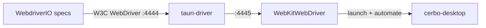

# Design

## Context

See proposal.md - Why. Relevant current state:

- Linux webview is WebKitGTK 4.1 (`webkitgtk_4_1` in `nix/deps.nix`); its Nix
  output already ships `bin/WebKitWebDriver`, so the driver always matches the
  webview version.
- Tauri enables WebKit automation at runtime when `TAURI_WEBVIEW_AUTOMATION=true`
  (`tauri-runtime-wry`), which `tauri-driver` sets. Release builds therefore
  work; no debug-only plugin is needed.
- `cerbo_core::CoreContext` resolves config and cache through XDG
  (`$XDG_CONFIG_HOME/cerbo`, `$XDG_CACHE_HOME/cerbo`), so pointing those
  variables at a temp dir isolates a session.
- The desktop binary is built with `nix build .#cerbo-desktop` (a plain
  `cargo` link fails in the agent sandbox).
- `tauri-driver` is not in nixpkgs.

## Goals / Non-Goals

**Goals:**
- One command (`bun run test:e2e`) that runs headless and isolated.
- Driver stack pinned through Nix so it matches the app's webkit.

**Non-Goals:**
- macOS/Windows drivers, CI workflow, Playwright, coverage of features beyond
  the smoke scenarios.

## Decisions

### Official `tauri-driver` + WebKitWebDriver + WebdriverIO

```
WebdriverIO (mocha) ──HTTP:4444──▶ tauri-driver ──▶ WebKitWebDriver ──▶ cerbo-desktop (WebKitGTK)
                                                        (port 4445)        TAURI_WEBVIEW_AUTOMATION=true
```



- Alternatives: `tauri-plugin-wdio-webdriver` / `tauri-plugin-webdriver`
  (embedded server inside the app) add a dependency and a capability to the
  app and only pay off on macOS; `tauri-plugin-playwright` drives the real
  webview only through its own Playwright-like API and is young; Playwright
  with `mockIPC` does not exercise the Rust side.
- Sources: [Tauri WebDriver docs](https://tauri.app/develop/tests/webdriver),
  [WebdriverIO Tauri platform support](https://webdriver.io/docs/desktop-testing/tauri/platform-support),
  [tauri-plugin-webdriver](https://docs.rs/crate/tauri-plugin-webdriver/latest/source/README.md),
  [tauri-plugin-playwright](https://docs.rs/crate/tauri-plugin-playwright/latest/source/README.md).

### Plain WebdriverIO, not `@wdio/tauri-service`

The config spawns `tauri-driver` itself in `onPrepare`/`onComplete`, as in the
Tauri docs. Fewer moving parts, and the binary path and environment stay under
our control. The service can be adopted later if multi-platform runs are
wanted.

### Package `tauri-driver` with `rustPlatform.buildRustPackage`

Built from the crates.io tarball (`fetchCrate`) in `nix/pkgs.nix`, exposed as
`packages.tauri-driver` and added to the devshell with `xvfb-run` and the
`webkitgtk_4_1` output that holds `WebKitWebDriver`. `tauri-driver` is pointed
at that binary with `--native-driver` so `$PATH` order cannot pick another one.

### Isolation per session

A `beforeSession` hook creates a temp root, sets `XDG_CONFIG_HOME`,
`XDG_CACHE_HOME` and `XDG_DATA_HOME` for the launched app, copies
`test-vault/` into it when the spec asks for a vault, and writes
`vaults.toml` registering that copy. Environment is passed to the app via the
driver process environment, since WebKitWebDriver launches the binary as its
child. Each spec file gets its own session (WebdriverIO default), so its own
app process and temp root.

### Binary path

The suite uses `CERBO_DESKTOP_BIN` if set, else `./result/bin/cerbo-desktop`
from `nix build .#cerbo-desktop`; it fails fast if the file is missing.

### Headless

`test:e2e` wraps WebdriverIO in `xvfb-run -a` when `DISPLAY` is unset; with a
display it runs directly so developers can watch.

## Risks / Trade-offs

- [The app writes window bounds / settings on exit] → all writes go to the
  temp XDG dirs; removed in `afterSession`.
- [Driver hangs on webkit version mismatch] → WebKitWebDriver comes from the
  same `webkitgtk_4_1` derivation the app links.
- [`decorations: false` custom title bar] → tests target DOM elements, not
  native chrome; no impact.
- [GTK4 / WebKitGTK 6 in Tauri 3] → only the driver package attribute changes;
  specs and harness stay.
- [Nix build is slow before every run] → the suite does not rebuild; the
  developer builds once and reruns.

## Open Questions

- Whether to wire the suite into `release.yml` or a separate CI workflow
  (deferred, out of scope).
</content>
