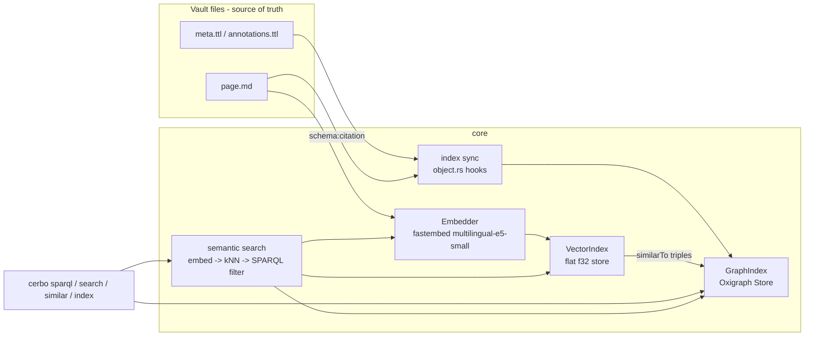
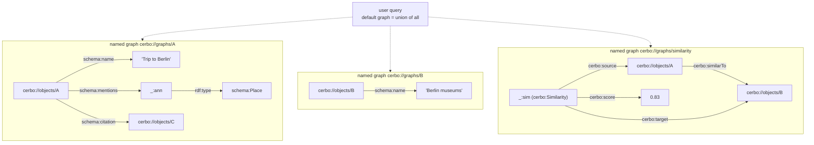
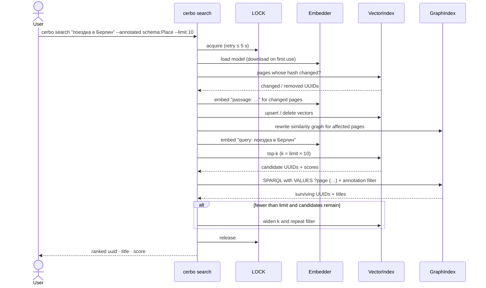
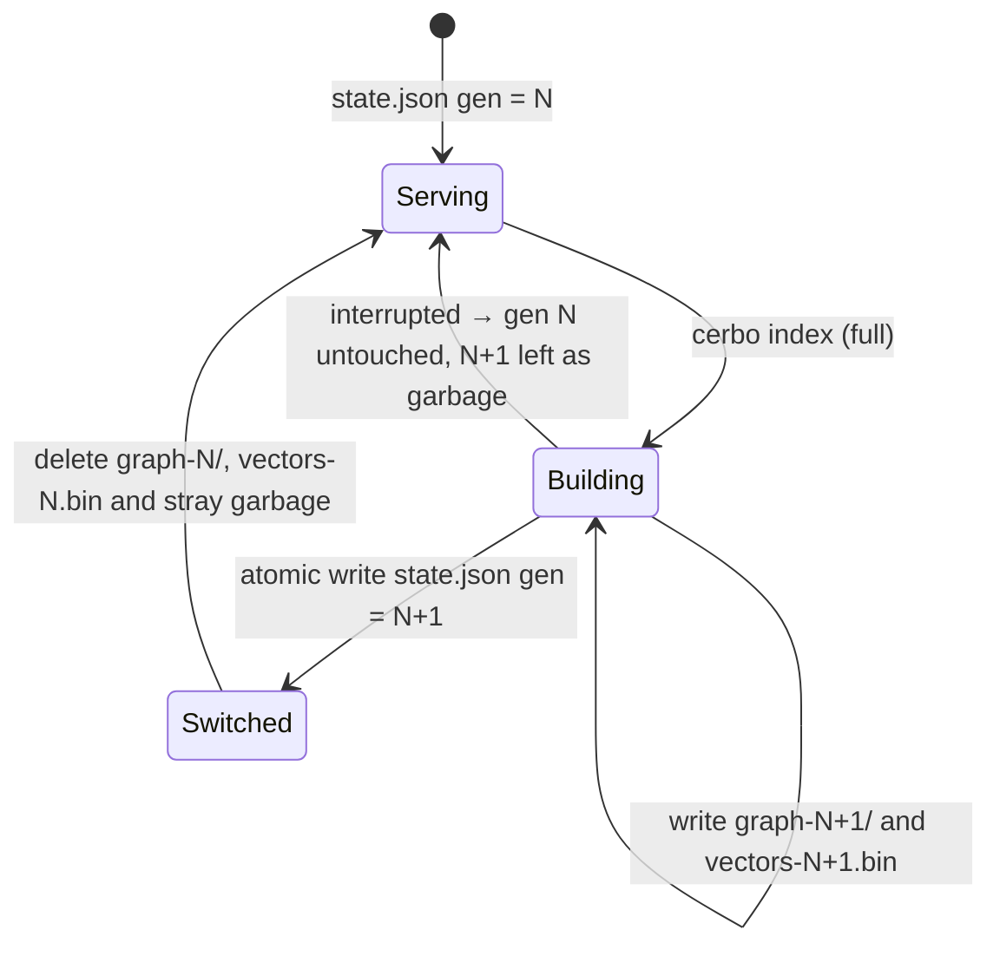
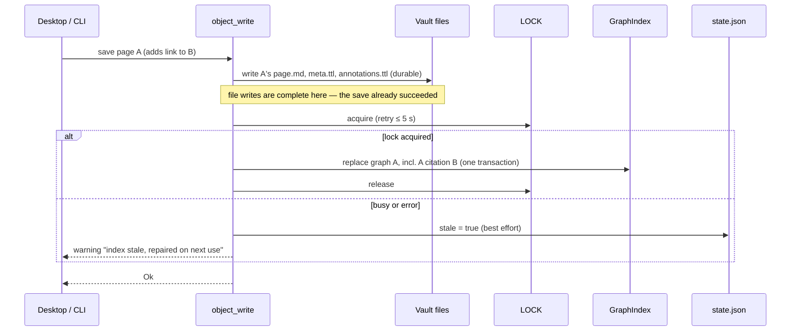

# Design

## Context

See proposal.md for motivation; requirements are in `specs/`.

Current state that shapes the approach:

- Each object lives in `.cerbo/objects/<uuid>/` with `meta.ttl`, `annotations.ttl` and `page.md`, plus today a `backrefs.ttl` backlink cache that this change removes. Files are the source of truth.
- Saving page A rewrites `backrefs.ttl` of every object whose link status changed (`object.rs::update_backrefs`). Hub pages are rewritten by many saves, which causes sync conflicts across devices.
- Vocabulary follows `normalize-rdf-vocabulary` (`rdf:type`, `https://schema.org/`), which lands first.
- All Turtle I/O goes through `core/src/rdf.rs`, which uses `oxrdf =0.3.5` and `oxttl =0.2.5`.
- Writes happen in `core/src/object.rs`: `object_create*`, `object_write` and `object_delete`. Full reindex happens in `core/src/metadata_index.rs::index_vault`.
- The CLI (`cli/src/main.rs`) and the Tauri app (`src-tauri`) both call `cerbo-core` and may run at the same time on the same vault.
- Builds go through Nix (`nix build .#cerbo .#cerbo-desktop`). There is no network inside the build sandbox.

## Goals / Non-Goals

**Goals:**

- One embedded, in-process index per vault: no server and no daemon.
- Index code isolated behind traits, so a storage engine can be swapped (for example, Grafeo) without touching the CLI or the specs.
- Saving a page stays fast: no model inference on the save path.
- Saving writes only the saved object's files; derived data lives only in the index.
- Nothing derived is written into the vault, so file sync never carries index files.
- Nix builds stay hermetic: nothing is downloaded at build time.

**Non-Goals:**

- No long-lived index handle in the desktop app, and no IPC between the app and the CLI.
- No approximate-nearest-neighbour (HNSW) index in this change; see D4.
- No full-text/BM25 search; see the proposal's Non-goals.
- No chunking of long pages. One embedding per page, using a truncated text.
- No `rdf-12` (RDF-star / triple terms) Oxigraph feature.
- No cleanup of the `durable-writes` and `object-trash` specs: their clauses about backreferences become vacuous and are tidied when this change is archived.

## Architecture



ASCII version:

```
 vault files (truth)            $XDG_CACHE_HOME/cerbo/index/<vault-key>/
 ┌───────────────────┐   sync    ┌──────────────────────────────────────┐
 │ meta.ttl          │──────────▶│ graph-<gen>/   Oxigraph (RocksDB)    │
 │ annotations.ttl   │           │   graph per object + similarity graph│
 │ page.md links ────┼──citation─▶│ vectors-<gen>.bin  flat f32 vectors  │
 │ page.md text ─────┼─embed────▶│ state.json  gen, format, stale, hash │
 └───────────────────┘           │ fingerprints  per-object file stats  │
                                 │ LOCK        advisory process lock    │
                                 └──────────────────────────────────────┘
        cerbo search "q":  embed(q) ─▶ kNN over vectors ─▶ VALUES ?page {…}
                           ─▶ SPARQL filter (--type/--annotated) ─▶ results
```

## Decisions

### D1. Oxigraph 0.5 as the graph store

We embed `oxigraph` 0.5.x with its default `rocksdb` feature. It pins `oxrdf =0.3.5` and, through `oxrdfio =0.2.7`, `oxttl =0.2.5`. These are exactly the versions core already uses, so `rdf.rs` types pass straight into the store with no conversion.

- **Alternatives:**
  - Grafeo: one engine for RDF, vectors and BM25, but vectors attach only to LPG nodes, and the project is young (see research).
  - In-memory `Store::new()` loaded on every command: no disk state, but reparsing every `.ttl` on each CLI call does not scale.
- **Build:** the bundled RocksDB needs Clang and lengthens builds. The `rocksdb-pkg-config` feature, which links nixpkgs RocksDB, is a later optimisation once version compatibility is checked.
  - Measured in task 1.1: `cargo tree -i oxrdf` shows one `oxrdf 0.3.5`. Clang comes from `rustPlatform.bindgenHook` in the dev shell and both packages.
  - `spareval 0.2.9` accepts `md-5`/`sha1`/`sha2` `>=0.10,<0.12`, and Cargo mixed `md-5`/`sha1` 0.11 with the existing `sha2` 0.10, which fails to compile. `Cargo.lock` pins `md-5` and `sha1` to 0.10.6. Do not run a blanket `cargo update` without rechecking this.
  - Bulk loads must go through one `BulkLoader::load_quads` call. One loader call per object writes RocksDB files per call: a 137 000-object build passed 5 GB before it was stopped, against 214 MB in 9 s with one call.

### D2. One named graph per object

Each object's triples go into the named graph `cerbo://graphs/<uuid>`: its `meta.ttl`, its `annotations.ttl`, and one `schema:citation` per distinct `cerbo://<uuid>` link in its `page.md`. Updating an object means `clear_graph` plus a load of these triples in one transaction, which removes stale triples exactly. Similarity triples live in `cerbo://graphs/similarity`.

Because links are stored on the **source** side, a save touches only the saved object's graph (D11).

User queries run with `dataset_mut().set_default_graph_as_union()`, so plain `SELECT … WHERE { … }` sees everything. The union is applied only when the query has no `FROM`/`FROM NAMED` of its own; otherwise it would override the query's dataset.

- **Alternative:** a single default graph with per-triple deletion. Rejected because computing which triples to remove requires diffing old files.

### D3. Short-lived opens guarded by an advisory lock

Every operation acquires an exclusive advisory lock on `<index dir>/LOCK`, opens the Store read-write, works, then closes and unlocks. Lock attempts retry with backoff for up to 5 s, then fail with "index busy".

`Store::open_read_only` is never used. Oxigraph documents it as undefined behaviour while another process writes, and it allows only one read-write Store at a time. Our own lock also covers the vector file and `state.json`, which RocksDB's lock does not. The lock uses `std::fs::File::lock`, stable since Rust 1.89; the dev shell has rustc 1.99, and a unit test (task 1.5) shows a second process is refused while the lock is held.

- **Alternatives:**
  - Desktop-held handle plus IPC from the CLI: faster, but adds a socket protocol.
  - CLI degraded mode: loses features whenever the app is open.
  - The user chose short-lived opens.
- **Cost:** a RocksDB open on each operation. Measured in task 1.4 (release build, warm page cache, median of 5 runs, 24-core NVMe machine):

  | Vault | Triples | Index size | Store open+close |
  |---|---|---|---|
  | `test-vault` (1 object) | 5 | — | 27.9 ms |
  | synthetic, 137 000 objects | 1 095 999 | 214 MB | 35.5 ms (a second series: 43.0 ms) |

  The open is within budget. The catch-up scan that follows it is not; see D12.

### D4. Exact (brute-force) vector search first

Vectors are stored as a flat little-endian `f32` matrix plus a UUID table, both normalised. Search is a dot-product scan. At 384 dimensions, 137 000 pages is about 210 MB and a single-threaded scan takes tens of milliseconds. That is enough for personal vaults, and exact search has no recall trade-off.

- **Alternative:** `usearch` (HNSW). It is fast, but it is a C++ library behind `cxx`, uses integer keys (so it needs a UUID↔key map), and adds a C++ toolchain step.
- Because search sits behind the `VectorIndex` trait, HNSW can be added later when a vault outgrows the scan.

### D5. Embeddings: fastembed-rs with multilingual-e5-small, ONNX Runtime loaded dynamically

`fastembed` with default features off and `ort-load-dynamic` enabled. Nix provides `onnxruntime`, and the package wrapper and dev shell set `ORT_DYLIB_PATH`, so nothing downloads at build time. The ONNX Runtime version must meet the `ort` crate's minimum API version and is checked in task 1.

- **Model:** `multilingual-e5-small` (384 dimensions) covers Russian and English.
  - The model is downloaded on first use into `$XDG_CACHE_HOME/cerbo/models/`; the user chose download over Nix bundling.
  - **Pinned:** Cerbo downloads the files itself from `https://huggingface.co/intfloat/multilingual-e5-small/resolve/<commit>/<file>` at commit `614241f622f53c4eeff9890bdc4f31cfecc418b3`: `onnx/model.onnx`, `onnx/tokenizer.json`, `onnx/config.json`, `onnx/special_tokens_map.json`, `onnx/tokenizer_config.json`. The SHA-256 of each is a constant in core (filled in task 1.2). Files are written to a temp name, verified, then renamed.
  - The model is loaded with `TextEmbedding::try_new_from_user_defined(UserDefinedEmbeddingModel::new(onnx, tokenizer_files).with_pooling(Mean), …)` (fastembed 7.5), so fastembed's own Hugging Face download feature is off and cannot fetch an unpinned revision. Mean pooling matches E5; this is confirmed against the model's `1_Pooling/config.json` in task 1.2.
  - Checked in task 1.2: `1_Pooling/config.json` at the pinned commit sets `pooling_mode_mean_tokens: true` and nothing else. The checksums are in `core/src/semantic/model.rs`; those of `model.onnx` and `tokenizer.json` equal the Hugging Face LFS object IDs. With the real model, `query: поездка в Берлин` and `query: trip to Berlin` have cosine 0.937.
  - fastembed 7.5 uses `ort 2.0.0-rc.15` with ONNX Runtime C API 24, so the runtime must be 1.24 or newer. The flake's nixpkgs ships `onnxruntime` 1.27.1.
  - `CERBO_MODEL_DIR` points at a directory with the same file names. Files there are verified but never downloaded. A Nix fixed-output derivation can provide that directory for fully offline installs.
  - E5 conventions apply: pages are embedded as `passage: <title>\n<text>` and queries as `query: <text>`, truncated to the model's 512-token window.
  - **Implemented in task 5.1** (`core/src/semantic/{model,embed}.rs`): downloaded files live in `$XDG_CACHE_HOME/cerbo/models/<commit>/onnx/…`. Each missing file is streamed (`ureq`, progress on stderr) into a `.cerbo-tmp-` file beside its destination, hashed, and renamed only if the SHA-256 matches. A mismatching download or cached file is deleted and the command fails naming the file; it is not downloaded again in the same run. Files in `CERBO_MODEL_DIR` are verified but never deleted, and a mismatch never falls back to a download. Pages are cut to 32 KiB of text before tokenizing, which bounds tokenizer work and stays far above 512 tokens. `ort` may panic instead of returning an error when ONNX Runtime cannot be loaded, so the load is wrapped in `catch_unwind` and reported as "embedding model unavailable". With the real model, `query: поездка в Берлин` scores 0.865 against an English Berlin passage and 0.753 against an unrelated one: E5 cosines sit high, which matters for the 0.80 threshold (D7, task 7.1).
- **Alternatives:**
  - Pure-Rust candle or static embeddings: no ONNX Runtime, but weaker multilingual quality.
  - Remote APIs: excluded by the specs.

### D6. Lazy embedding refresh

`state.json` stores a content hash (of title plus `page.md`) per embedded page. Saving a page never runs the model. `search`, `similar` and `index --embeddings` load the model anyway, so they first re-embed pages whose hash changed, delete vectors of removed pages, and then recompute similarity. This keeps saves fast and still meets the "fresh note is found" scenario.

- **Implemented in task 5.2/5.3** (`core/src/semantic/{vectors,similarity}.rs`):
  - `vectors-<gen>.bin` is a header (`CVE1`, width, count), the UUID table, then the rows as little-endian `f32`, all rewritten through `fsio::write_atomic`. A vault has embeddings exactly when the live generation has this file; until then `search`/`similar` fail with `NoEmbeddings`.
  - A page is a live object with a `page.md`. Its title comes from the graph, so a refresh runs after the catch-up. It is re-embedded when its hash differs or its vector is missing. The vector file is written before `state.json`, so a crash in between only re-embeds those pages next time.
  - A rebuild (D9) copies the live generation's vector file, its content hashes and its similarity graph into the new generation. When there is no live generation (missing index, other format version), the new one starts without embeddings and the user runs `cerbo index --embeddings` again.

### D7. Similarity links

After a refresh, for each changed page we compute its top 5 neighbours with a score of at least 0.80 (both are constants in core at first). Neighbours of unchanged pages are recomputed only when they pointed at a changed page. The similarity graph is written as follows:

```turtle
<cerbo://objects/A> cerbo:similarTo <cerbo://objects/B> .
[] a cerbo:Similarity ; cerbo:source <cerbo://objects/A> ;
   cerbo:target <cerbo://objects/B> ; cerbo:score 0.83 .
```

The plain triple keeps simple queries simple; the `cerbo:Similarity` node carries the score without RDF-star. The threshold is tuned on `test-vault` before the change is archived.

- **Implemented in task 5.4:** the score is an `xsd:decimal` with four digits. Besides the changed pages and the pages that pointed at a changed or removed page, a refresh also recomputes every page that a changed page now scores at least 0.80 against, so a new page appears in its neighbours' lists too. Links are recomputed on 8 threads; the first `cerbo index --embeddings` compares every page with every other one (quadratic, seconds for a few thousand pages). Removing an object's graph (trash, or a catch-up that finds it gone) also drops every similarity link from and to it with its score nodes, and a rebuild copies only the links between live pages. The vector of a trashed page stays until the next refresh, which then recomputes the lists of the pages it was close to, so they get a replacement neighbour. A refresh writes the links first, then the vectors, then the content hashes, so a failed link update is retried by the next refresh. A rebuild keeps the embeddings whenever the live generation's vectors survive, also when its store cannot be opened or its fingerprints are lost; without the store, the links are recomputed from the vectors (no model needed).
- **Threshold tuned in task 7.1: it stays at 0.80.** `test-vault` holds a single page ("Index", whose body is only its heading), so it cannot show noise. The run used a scratch copy with 12 more short pages: four related travel pages ("Trip to Berlin", "Berlin museums", the Russian "Выходные в Берлине", "Weekend in Munich"), "Paris vacation", and seven unrelated ones (a borscht recipe, groceries, Rust error handling, SPARQL notes, bicycle maintenance, a tomato garden, a dentist appointment). `cerbo search "поездка в Берлин"` ranks the Russian Berlin page first (0.876), then "Trip to Berlin" (0.844), Munich (0.806) and the museums (0.805); the unrelated pages score 0.718–0.742. Between pages, the travel pairs score 0.805–0.832, including the cross-language pair "Trip to Berlin"/"Выходные в Берлине" at 0.805. Two topically close pairs also pass: Rust/SPARQL at 0.805 and borscht/groceries at 0.803. The highest unrelated pair between two pages with real content is borscht/tomato garden at 0.793. Raising the threshold to 0.82 would drop "Berlin museums"/"Trip to Berlin" (0.817) and the cross-language pair. Lowering it to 0.78 would add noise such as borscht/"Trip to Berlin" (0.781). So 0.80 sits in a narrow gap of about 0.01 above the noise. That fits E5, whose cosines cluster high (see D5). The one wrong link the threshold cannot stop comes from the near-empty "Index" page, which scores 0.845 against groceries and 0.807 against the Russian Berlin page: a page with almost no text lands near everything. A minimum text length for similarity links would fix that, but it is left for the follow-up "Similar notes" change, because it needs a real vault to tune. `cerbo search` and `cerbo similar` do not use the threshold. They always return the top `--limit` pages.

Graph layout inside the Store (D2 + D7):



```
 cerbo://graphs/A            cerbo://graphs/B          cerbo://graphs/similarity
 ┌───────────────────────┐   ┌──────────────────────┐  ┌──────────────────────────────┐
 │ A title "Trip…"       │   │ B title "Berlin…"    │  │ A similarTo B                │
 │ A mentions _:ann      │   └──────────────────────┘  │ _:sim source A; target B;    │
 │ _:ann a schema:Place  │                             │       score 0.83             │
 │ A citation C          │                             └──────────────────────────────┘
 └───────────────────────┘
          ▲ replaced as a whole on every upsert          ▲ recomputed after refresh
 queries see the union of all graphs (unless the query declares FROM / FROM NAMED)
```

### D8. Graph-filtered search via `VALUES`

kNN returns candidate UUIDs, more than `--limit` (×10, widened until enough survive or the vault is exhausted). Core then runs a SPARQL query with `VALUES ?page { … }` plus the `--type`/`--annotated` patterns and keeps the kNN order. This satisfies "filters apply before limit" without custom SPARQL functions.

- **Alternative:** register a custom SPARQL function (`with_custom_function`) for similarity. It is more expressive, but a per-row function cannot use an index. Deferred.
- **Implemented in task 5.5:** `SemanticIndex::nearest` asks the vector index for `limit × 10` candidates, filters them in `VALUES` blocks of at most 1000 IRIs, and multiplies the candidate count by 10 until `limit` pages pass or the vault is exhausted. `--type` and `--annotated` values are `prefix:Name` (resolved with the same prefixes as `cerbo sparql`: `cerbo:`, the built-ins, then the vault map), `<iri>` or an absolute IRI; several values must all match. An unknown prefix is `SemanticError::InvalidFilter`. Core entry points for group 6: `semantic::{refresh_embeddings, search, similar}` with `SearchOptions { limit (default 10), types, annotated }`, `SearchHit { uuid, title, score }`, `FastEmbedder::load(cache_dir)`, and `MockEmbedder` (feature `test-utils`).

- **Implemented in group 6 (CLI):** `cerbo search`, `cerbo similar` and `cerbo index --embeddings` get their model through `semantic::default_embedder`, a `LazyEmbedder` that loads (and on first use downloads) the model only on the first `embed` call. So a vault without embeddings, an unknown page, or a `similar` with nothing changed never touches the model or the network. `--vault` takes a path, like `index` and `sparql`. `index --embeddings` refreshes the whole vault even with `--page` (only changed pages are embedded). CLI tests swap in `MockEmbedder` through `CERBO_TEST_MOCK_EMBEDDER`, which only builds with feature `test-utils` honour (the CLI's dev-dependency enables it while tests are built; the packaged binary ignores it). The synonym and Russian-query scenarios need the real model: `real_model_synonym_and_cross_language_search_offline` is ignored by default and runs with `CERBO_MODEL_DIR`.

`cerbo search` flow (D6 + D8):



```
 user ─▶ cerbo search "q" --annotated schema:Place --limit 10
          │ acquire LOCK (retry ≤ 5 s)
          │ load model ──▶ refresh changed pages: embed ▶ vectors ▶ similarity graph
          │ embed("query: q")
          │ kNN top (limit×10) ──▶ candidates
          │ SPARQL: VALUES ?page {candidates} + ?page schema:mentions/a schema:Place
          │ fewer than limit? ──yes──▶ widen k, repeat
          │ release LOCK
          ▼
        ranked list: uuid · title · score
```

### D9. Atomic rebuild via generations

A full rebuild writes into `graph-<gen+1>/` and `vectors-<gen+1>.bin`, then atomically replaces `state.json` (using the existing durable-write helper in `fsio.rs`) to point at the new generation, then deletes the old one. An interruption leaves `state.json` pointing at the previous complete generation. `state.json` also holds `format_version`; a mismatch triggers an automatic rebuild.



```
 state.json: gen=N ──cerbo index──▶ build graph-N+1/, vectors-N+1.bin
        ▲                               │                    │
        │ interrupted (gen N intact)    │ complete           │
        └───────────────────────────────┘                    ▼
                                         atomic write state.json gen=N+1
                                                             │
                                         delete gen N files and garbage
```

- **Implemented in group 4:** a full `cerbo index` rebuilds into a new generation (or builds the index when it has none) after regenerating annotations and deleting leftover `backrefs.ttl` files of live objects; `--page` calls `update_objects` for that page only. If the index cannot be updated (busy, say), the files stay written and the command exits non-zero. `triples` in the summary is the store's quad count. `cerbo sparql` formats the owned `QueryOutput` in core (`to_text`, `to_json`): Turtle through `rdf::serialize`, SPARQL Results JSON through sparesults, JSON-LD through oxrdfio. The table shows IRIs bare and literals by value; `--json` gives exact terms.

### D10. Sync hooks never fail the write

The hooks in `object.rs` run after the file writes succeed. Any index error is logged and sets `stale: true` in `state.json`, best effort; a crash before that is caught by the next catch-up step because the fingerprints differ (D12). The desktop app gets index sync for free because it calls the same core functions.

- **Implemented in task 3.2/3.3:** the hooks call `semantic::sync_objects`, which re-indexes the named object whatever its fingerprint says (Cerbo itself just wrote it, possibly within the file system's timestamp granularity) and stores its new fingerprint, so the next catch-up has nothing to do. A page save updates the graph once, after `page.md`, `meta.ttl` and `annotations.ttl`. A hook does nothing when the vault has no index yet (the first operation that needs one builds it from the files, so a save never pays for a build) or when the index is already stale (the next operation rebuilds it). Staleness is set without the lock, because the holder may be stuck, and therefore as a separate `STALE` marker file next to `state.json`, never by rewriting `state.json` (that could undo a generation switch the holder made meanwhile, and lose its embeddings). Opening the index treats the marker like `stale: true`; a rebuild deletes it before its scan, so a marker set while it runs survives it, and sets it again if the rebuild fails. The CLI hooks wait up to 5 s for the lock; the desktop app declares that it watches the vault (`semantic::set_sync_watched`), so a save never waits for the index and one that finds it busy skips the update without marking the index stale: the watcher reports the written object to the app's index worker, which catches it up. Marking it stale there would turn the worker's next update into a full rebuild, repeated while the user keeps typing. Other failures still mark the index stale. A live generation whose store cannot be opened or whose fingerprint table is unreadable is rebuilt, never a lasting error. Hooks run only for contexts whose `config_dir` is a vault's `.cerbo/`.

Page save path (D3 + D10):



```
 save page A ─▶ write A's page.md / meta.ttl / annotations.ttl   (save succeeds here; B untouched)
                │
                ├─ LOCK acquired ─▶ replace graph A (incl. citation B) ─▶ release
                │
                └─ busy / error ──▶ state.json stale=true, warn on stderr
                                    (next operation repairs it via catch-up, D12)
 no model inference on this path — embeddings refresh lazily on search (D6)
```

### D11. Backlinks are a query over source-side links

`backrefs.ttl` is removed. Each page's graph records its own outgoing links, and backlinks are:

```sparql
SELECT DISTINCT ?src ?title WHERE {
  GRAPH ?g { ?src schema:citation <cerbo://objects/T> }
  ?src schema:name ?title
} ORDER BY ?title ?src
```

- A save replaces one graph. There is no fan-out to targets, no hub rewrites, and no sync conflicts on hub files.
- Links to missing objects are kept, so broken links are a query (`?a schema:citation ?t FILTER NOT EXISTS { ?t a ?c }`). A page created later with that UUID shows the backlink at once.
- Core exposes `backlinks(vault_ctx, uuid) -> Vec<BacklinkEntry { uuid, title }>`, used by `cerbo page backlinks` and by the Tauri `backlinks_get`.
- `attachment_list` today reads `backrefs.ttl`. It becomes "links in this page's `page.md` whose target is an Attachment", parsed directly from `page.md`, so it does not need the index.
- `update_backrefs` shrinks to broken-link detection: an existence check per target, no writes.
- **Implemented in group 3:** `update_backrefs` became `object::broken_links(ctx, content)`, which reports every broken target in the saved content (not only newly added ones). `cerbo index` already stops writing `backrefs.ttl` here, because the API it used is gone; deleting leftover files and the new summary fields stay with task 4.1. The SPARQL uses full IRIs instead of `schema:`, because a vault's prefix map may redefine that prefix. A page with two titles is listed once, under the first title in sort order. An id that is not a UUID or not a live object is `SemanticError::ObjectNotFound` ("Object not found").
- **Desktop (task 3.6):** `backlinks_get` is an async command that opens the index on a blocking thread and returns a tagged error: `building` until the vault-open catch-up has finished (the panel shows a loading state and reloads on the `semantic-index-ready` event); while that catch-up keeps failing, the error of its last attempt (`indexBusy` or `unavailable`), announced with the same event so the panel never stays on "Loading"; `indexBusy` after the 5 s retry limit (the panel shows "temporarily unavailable"), or `unavailable` with a message. It runs a full catch-up first only when the index is stale or the watcher lost events.
- **Alternatives:**
  - Keep `backrefs.ttl` as an optional export: it keeps every problem above.
  - Store links as `schema:citation` in a vault file: duplicates `page.md`.

### D12. Catch-up by file fingerprints

The index is per machine, so changes that arrive through git or file sync never pass through Cerbo's save hooks. Before answering, every operation that opens the index runs a catch-up step:

1. List `.cerbo/objects/` (trash excluded) and `stat` `meta.ttl`, `annotations.ttl` and `page.md` of each object.
2. Compare `(mtime_ns, size)` with the fingerprint table stored next to the Store.
3. Re-upsert changed or new objects and remove vanished ones in one transaction, then save the new fingerprints.

- When the stale flag from D10 is set, catch-up re-upserts every object instead of trusting fingerprints (a failed hook may have left an object half-updated), then clears the flag.
- The cost is three `stat` calls per object. This is measured together with the Store open time in task 1.4 (137 000 objects ≈ 411 000 `stat` calls). If it is too slow, the desktop app runs catch-up on vault open and on file-watcher events (it already watches the vault), and the CLI runs it per command.
- **Measured in task 1.4** (same setup as D3; no file changed, so every fingerprint matched; the table was a flat binary file of 137 000 records):

  | Vault | Catch-up scan | Open+close plus catch-up |
  |---|---|---|
  | `test-vault` (1 object) | < 0.1 ms | 28.0 ms |
  | synthetic, 137 000 objects | 791.5 ms (a second series: 797.2 ms) | 832.2 ms |

  Breakdown at 137 000 objects: loading the table about 37 ms, listing `objects/` about 45 ms, and the 411 000 `stat` calls with comparison about 700 ms on one thread. The same `stat` calls on 8 threads take about 95 ms.
- **Decision (user, after task 1.4): hybrid.**
  - The full scan runs the `stat` calls on a pool of 8 threads (`std::thread::scope`, no new dependency): about 180 ms at 137 000 objects, milliseconds for typical vaults.
  - The **CLI** runs the full scan before every command that opens the index.
  - The **desktop app** runs the full scan once when a vault is opened. After that it does not scan per operation: the existing `notify` watcher (`src-tauri/src/index.rs`) reports changed paths under `.cerbo/objects/<uuid>/`, and the app re-upserts just those objects (debounced, batched into one transaction). If the watcher reports an error or overflow, or the stale flag is set, the next operation falls back to a full scan.
- **Implemented in task 2.4:** the stale flag triggers a full rebuild into a new generation (D9) rather than a re-upsert transaction: it re-indexes every object as required, uses one bulk load instead of one huge transaction, and is atomic. The fingerprint table is `fingerprints-<gen>.bin` next to `graph-<gen>/`, so a rebuild switches both together. The desktop worker (`src-tauri/src/index.rs`) debounces watcher events for 300 ms and retries a failed update as a full scan after 2 s. Opening a vault without `.cerbo/objects/` creates that directory, so the watcher has something to watch.
- **Alternative:** content hashes. They are exact but read every file on each command. Fingerprints first; the content hash in `state.json` stays for embeddings (D6).

### D13. Index location in the XDG cache

The index lives in `$XDG_CACHE_HOME/cerbo/index/<vault-key>/`. `<vault-key>` is the first 16 hex characters of the SHA-256 of the vault's canonical path. `state.json` records that path to detect collisions.

- Indexes are per machine. Syncthing, Dropbox and git never see them, so two devices can never corrupt each other's RocksDB.
- A moved vault gets a fresh index, built automatically (spec "Missing or incompatible index is built automatically").
- If `state.json` names another vault path (a key collision), the index is rebuilt for the vault being opened, with a warning. Two colliding vaults would rebuild each other's index on every switch, which stays correct.
- **Alternatives:**
  - `.cerbo/index/` inside the vault (the earlier choice): depends on every sync tool honouring an ignore rule.
  - A key from the vault registry ID: vaults discovered from the working directory may not be registered.

## Risks / Trade-offs

- [Backlinks now depend on the index, which may be busy or still building] → The panel shows a non-blocking message or a loading state. Saving never depends on the index (D10).
- [RocksDB open plus catch-up on every operation is slow] → Measure in task 1.4. Fallbacks: the desktop keeps catch-up event-driven, and both sides batch updates with a short debounce.
- [Mixed versions: an older Cerbo on another device keeps writing `backrefs.ttl`] → New builds ignore the files and the next full `cerbo index` deletes them. Upgrade all devices; this is in the man page.
- [Orphaned indexes in the cache after vaults are moved or deleted] → They are only disk usage and can be removed by hand. A `cerbo index --prune` is a possible follow-up.
- [ONNX Runtime version mismatch at runtime] → Check the version at startup and fail with a clear message. The minimum is pinned in the Nix wrapper.
- [Model download blocked (offline, proxy)] → Clear error plus `CERBO_MODEL_DIR`.
- [Pinned model revision disappears from Hugging Face] → Checksums still protect integrity. `CERBO_MODEL_DIR` and a Nix fixed-output derivation give a mirror path.
- [Brute-force search on very large vaults] → `VectorIndex` trait; add HNSW later.
- [Binary size and build time grow (RocksDB, ort)] → The graph index is required now, so `oxigraph` is a normal dependency of core. Embeddings stay behind an `embeddings` cargo feature, enabled in the CLI and desktop packages.

## Migration Plan

1. Land `normalize-rdf-vocabulary` first.
2. On upgrade, the first operation that needs the index builds it in the cache. Backlinks work immediately afterwards, even before any `backrefs.ttl` is deleted, because they are no longer read.
3. The next full `cerbo index` deletes leftover `backrefs.ttl` files and reports the count. `test-vault` is cleaned in the implementation commit.
4. Rollback: an older Cerbo needs its `backrefs.ttl` files back. Restore them from git or sync history, or run the old build's `cerbo index`, which regenerates them from `page.md`. Deleting the cache index is always safe.

## Open Questions

- Should the similarity threshold (0.80) and the neighbour count (5) be configurable per vault? This can be decided after tuning; the specs do not change.

## Sources

Perplexity is not available in this session; facts were checked with web search and the docs below.

- Oxigraph `Store` (open, read-only caveat, single writer, transactions): https://docs.rs/oxigraph/0.5.13/oxigraph/store/struct.Store.html
- Oxigraph `SparqlEvaluator` (prefixes, custom functions, cancellation): https://docs.rs/oxigraph/0.5.13/oxigraph/sparql/struct.SparqlEvaluator.html
- Union default graph: https://docs.rs/oxigraph/latest/oxigraph/sparql/struct.QueryDatasetSpecification.html, https://github.com/oxigraph/oxigraph/discussions/1133
- Oxigraph 0.5.13 dependency pins: https://crates.io/crates/oxigraph/0.5.13
- RocksDB build options: https://lib.rs/crates/oxrocksdb-sys
- fastembed-rs and its multilingual models: https://github.com/anush008/fastembed-rs
- ort dynamic loading and `ORT_DYLIB_PATH`: https://ort.pyke.io/setup/linking, https://github.com/nicosuave/memex/pull/214, https://blog.stark.pub/posts/bundling-onnxruntime-rust-nix/
- usearch (alternative to D4): https://unum-cloud.github.io/USearch/rust/index.html
- Grafeo (alternative to D1): https://grafeo.dev/user-guide/vector-search/
- fastembed `UserDefinedEmbeddingModel` / `try_new_from_user_defined` (7.5.0): https://docs.rs/fastembed/7.5.0/fastembed/struct.UserDefinedEmbeddingModel.html
- multilingual-e5-small files and revision: https://huggingface.co/api/models/intfloat/multilingual-e5-small
