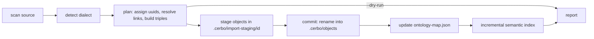

# Design

## Context

- Objects live in `.cerbo/objects/<uuid>/` with `meta.ttl` (Turtle, written by
  `ObjectMeta::to_turtle_with`, which already accepts extra triples it does not
  model) and `page.md`. Pages are `rdf:type schema:NoteDigitalDocument`.
- `object_create_with_metadata` sets title, slug and virtual path;
  `slug::slugify` transliterates non-ASCII (`филаменты` → ASCII).
- Attachments are objects holding the file plus `meta.ttl`; pages record them
  in `relations.ttl` as `:usesAttachment`.
- `.cerbo/ontology-map.json` (v2) maps a prefix to `{namespace, ontology}`.
- `rdf::uuid_from_object_iri` treats anything starting with `cerbo://objects/`
  as an object id, so an imported vocabulary must not live under that prefix.
- `core` has no YAML parser and no Markdown parser; links are found by regex.
- Real Tolaria vaults on hand (`~/Sync/Tolaria/Braindump`, 117 notes): H1 is
  the title, `type:` in frontmatter, `_favorite`/`_organized` app state,
  `attachments/{pdf,photos}/` referenced by ordinary Markdown links,
  `[[wikilinks]]` to file stems and to titles, `views/*.yml`, `AGENTS.md`.

## Goals / Non-Goals

**Goals:**
- One pass over the source builds a complete plan (uuids, links, triples)
  before anything is written, so `--dry-run` and the real run share one code path.
- Nothing half-imported is ever visible in the target vault.
- Adding a third format later means one new `Dialect`, not changes to the writer.

**Non-Goals:**
- Streaming huge vaults: the plan is held in memory (a 10 000-note vault is
  tens of MB of text, acceptable).
- Preserving byte-exact Markdown: only link syntax and frontmatter are touched.
- Desktop UI, sync, re-import (see proposal).

## Decisions

### D1. Pipeline: scan → plan → stage → commit → index

```
source dir ──scan──▶ [SourceFile] ──plan──▶ ImportPlan ──stage──▶ .cerbo/import-staging/<id>/
                                               │                         │
                                         --dry-run: report          commit: rename each
                                                                    object dir into objects/,
                                                                    then prefix map, then index
```



The plan assigns every note and referenced file its UUID first, so link
rewriting is a lookup. Staging is inside the target vault's `.cerbo/` so the
final `rename(2)` is on one filesystem and atomic per object. Commit order:
attachments, pages, ontology object, prefix map. A crash mid-commit leaves
some objects live; on the next `import-vault` run a leftover staging folder is
detected, and its already committed objects (listed in a `manifest.json`
written before commit starts) are moved to the trash before the error is
reported. Alternative considered: one staging vault swapped in whole. Rejected:
the target vault usually already holds pages.

### D2. Dialects

A `Dialect` trait answers: is this file a note, how to get its title, which
frontmatter keys to drop, how to map special keys. `Obsidian` (title = stem,
`tags`→`schema:keywords`, `aliases`→`schema:alternateName`, skip `.obsidian`,
`.canvas`) and `Tolaria` (title = first H1, `type`→`rdf:type`, drop `_*`, skip
`views/`). Detection lives next to each dialect. Link syntax is shared, since
both use the same wikilink and Markdown link forms.

### D3. Link resolution index

Built once from the plan: maps of lowercase relative path (with and without
`.md`), stem, title and alias to a list of UUIDs. Lookup order per spec; with
several candidates, pick the one whose folder shares the longest prefix with
the linking note, else the shortest path (this follows Obsidian's own "shortest
path when possible" behaviour, [Obsidian help: internal
links](https://www.mintlify.com/obsidianmd/obsidian-help/linking/internal-links)),
and record it as ambiguous. Files (attachments) are resolved by relative path
first, then by file name anywhere in the vault, which is how Obsidian embeds
like `![[photo.png]]` work regardless of the attachment folder setting.

### D4. Skipping code when rewriting

Rewriting must not touch `[[x]]` inside code. Use `pulldown-cmark`'s
`into_offset_iter()` to collect byte ranges of code blocks and inline code,
then apply regex rewrites only outside them, splicing from the end of the
string backwards so offsets stay valid. Alternative: a hand-written fence
tracker. Rejected: indented code, nested fences and backtick runs are easy to
get wrong. Sources: [pulldown-cmark on docs.rs](https://docs.rs/crate/pulldown-cmark/*),
[offset-based code block detection in rumdl](https://docs.rs/crate/rumdl/0.2.4/source/src/utils/code_block_utils.rs).

### D5. YAML parser

`serde_yaml` is archived (RUSTSEC-2025-0068). Use `serde-saphyr`, the
maintained, `unsafe`-free option. It has no generic `Value` type, so
frontmatter is parsed into our own enum
(`Scalar(String|Bool|Int|Float) | List | Map`) via a custom `Deserialize`.
Alternative: `serde_norway`/`serde_yaml_ng`, drop-in forks, rejected because
both have gone without releases for over a year. Frontmatter that fails to
parse is not fatal: the note is imported with the raw block kept at the top of
`page.md` inside a ```` ```yaml ```` fence and listed in the report. Sources:
[RUSTSEC-2025-0068](https://api.osv.dev/v1/vulns/RUSTSEC-2025-0068),
[comparison in rubyatscale/pks#46](https://github.com/rubyatscale/pks/pull/46),
[Rust YAML guide](https://mojoauth.com/dev-guides/parse-and-generate-yaml-with-rust).
Verify the current `serde-saphyr` version before adding it (sources disagree
between 1.1 and 1.3).

### D6. Vocabulary namespace

Namespace `cerbo://vocab/<ontology-uuid>/`. Keys become local names after
percent-encoding anything that is not an IRI-safe character (`Belongs to` →
`Belongs%20to`), so keys stay recognisable and no two keys collide. Using
`cerbo://objects/<uuid>#` was rejected because the index would read such IRIs
as links to the ontology object (see Context). The ontology object's `page.md`
lists the classes and properties found, with counts; its `meta.ttl` holds
`schema:url "file://<canonical source path>"`, `cerbo:importFormat` and
`schema:dateCreated`. The "one import per source" check reads these from the
vault's Ontology objects, so no separate import registry file is needed.

### D7. Target selection

Prompt on stderr, answer from stdin; plain numbered list, no new TUI crate
(`std::io::IsTerminal` decides whether prompting is allowed). `--new` reuses
the code behind `cerbo init` and `vault_add`. The vault is created only after
the plan succeeds, so a source with a fatal error does not leave an empty new
vault behind.

### D8. Index

After commit, run the same incremental refresh that `cerbo page backlinks`
already triggers (it picks up objects added outside Cerbo), not a full
`cerbo index`. One refresh per import, not per page.

## Risks / Trade-offs

- [Tolaria detection is heuristic] → `--from` always wins; the report states
  which format was used and why.
- [Links to headings lose the heading (`cerbo://` has no fragment)] → link
  text keeps the alias or title; the report counts dropped fragments. A later
  change can add `cerbo://<uuid>#heading`.
- [Very large attachments double disk usage during staging] → staging is
  removed after commit; the dry-run report shows the total attachment size.
- [Frontmatter keys with spaces or Cyrillic make ugly IRIs] → acceptable;
  they stay readable after decoding and the ontology page lists them.
- [Wikilinks in Obsidian may point to files outside `.md` (e.g. `[[file.pdf]]`)]
  → handled as attachments by the same file resolution.
- [`AGENTS.md`/`CLAUDE.md` in Tolaria vaults are notes with `type: Note`] →
  imported like any note; the user can delete them. No special casing.

## Migration Plan

Additive: new command and module, no change to existing data. Rollback is
deleting the imported pages (they are listed by `cerbo page list` and can be
found by their import ontology).

## Open Questions

- Should the import ontology's classes and properties be written as
  `rdfs:Class`/`rdf:Property` triples into an `ontology.ttl` file, or is the
  generated `page.md` enough until SPARQL queries need them? Does not change
  the import's behaviour for pages.
