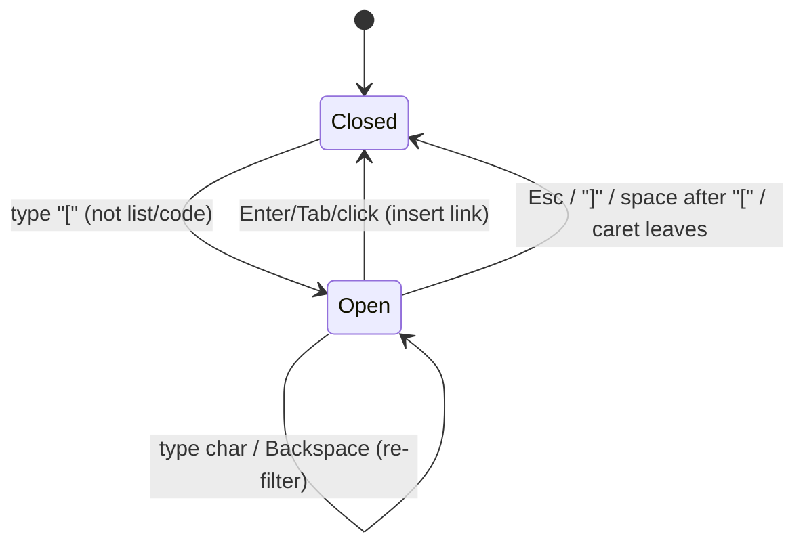

# Design

## Context

See proposal.md — Why. Current state found in the code:

- The editor is Carta (`carta-md`) in `mode="tabs"`, wrapped by
  `src/lib/PageEditor.svelte`. Carta mounts **both** `Input` and `Renderer`;
  `Renderer` gets `value` even while hidden, so the full remark/rehype pipeline
  (our mention, wikilink, task-list plugins, plus the shiki `code` plugin) runs
  every `rendererDebounce` (300 ms) during typing.
- Carta's `Input` keeps a shiki-highlighted overlay under the textarea. On
  **every keystroke** it runs `speculativeHighlight`, which reads
  `highlightElem.innerHTML` (the whole document as HTML), patches it and writes it
  back — O(document) DOM work per key. A full shiki re-highlight follows after
  `highlightDelay` (250 ms) and nested-language loading after 300 ms.
- `WikilinkAutocomplete.svelte` listens to `input` and regex-scans
  `value.slice(0, caret)` per key (cheap), and builds a mirror `div` for caret
  coordinates when open (forces layout).
- `attachment_upload`, `cursor_position_save` and `cursor_position_load` in
  `src-tauri/src/page.rs` are TODO stubs. The path-based `attachment_add`
  command works. `object::attachment_list` derives a page's attachments from
  `cerbo://` links in `page.md`, so inserting the link is what attaches.
- Tauri v2 has `dragDropEnabled` on by default: OS file drops arrive as a native
  event with absolute paths, and HTML5 `drop` does not fire for files.

```
keydown ─► textarea paints char? ── blocked by ──┐
                                                  │
   per key:  speculativeHighlight (innerHTML r/w) │  ◄─ suspect #1
             autocomplete regex / mirror layout   │  ◄─ suspect #3
   +250 ms:  shiki full highlight of overlay      │  ◄─ suspect #2
   +300 ms:  hidden Renderer: remark→rehype→shiki │  ◄─ suspect #2
   +800 ms:  autosave (IPC, async)                │
```

### Measured cost per keystroke (task 1.1, partial)

The 137 KB fixture page is generated by `e2e/fixtures/large-page.ts`; the e2e
session adds it to its vault copy, and `bun e2e/fixtures/large-page.ts
test-vault` adds it to `test-vault` for a manual `bun run dev-debug` session.
It is not committed, so the vault specs keep their page counts.

Outside the webview, `bun scripts/bench-overlay-diff.ts` times Carta's per-key
`diffChars` (the first step of `speculativeHighlightUpdate`) in JavaScriptCore,
one character inserted mid-page, 137 keys per size, two runs on the agent
machine (loaded; numbers vary between runs):

| page   | run 1 p50 / p95 | run 2 p50 / p95 |
| ------ | --------------- | --------------- |
| 10 KB  | 0.3 / 7.6 ms    | 0.4 / 3.5 ms    |
| 25 KB  | 0.8 / 7.1 ms    | 0.8 / 1.5 ms    |
| 50 KB  | 2.4 / 11.1 ms   | 1.8 / 3.1 ms    |
| 75 KB  | 7.0 / 18.2 ms   | 2.9 / 5.0 ms    |
| 100 KB | 8.0 / 23.4 ms   | 4.3 / 11.7 ms   |
| 137 KB | 20.2 / 40.6 ms  | 5.7 / 12.3 ms   |

This is one function without its DOM rewrite (`innerHTML` read and write of the
whole overlay), so it is a lower bound. It sets the first plain-textarea
threshold at 50 KB (`LARGE_DOCUMENT_CHARS`), back to the overlay below 40 KB.
**Still open:** the WebKit Inspector timeline in the webview, with the cost per
function per keystroke and a second run, needs a human at the reference
machine; adjust the threshold from it.

## Goals / Non-Goals

**Goals:**
- Measure before changing: every latency fix is backed by a trace.
- Keep Carta and the markdown-source editing model.
- Reuse existing object storage for drops; no new object type.

**Non-Goals:**
- Swapping the editor engine (only a fallback if Decision 1 fails the budget).
- Virtualised rendering of very large pages.
- Storing cursor positions inside the vault (they are per-machine UI state).

## Decisions

### 1. Typing latency: profile, then cut the per-key path

First record a WebKit Inspector timeline (`bun run dev-debug`) typing 137
characters into a 137 KB page, and attribute time per keystroke. Expected fixes,
in order, each kept only if the trace shows a win:

1. **Do not render the hidden preview.** Pass the renderer a value that only
   updates when `selectedTab === 'preview'` (or the user pauses ≥ 1 s). Carta has
   no option for this, so feed `Renderer` through a wrapper/patch, or render the
   preview ourselves with `<Markdown>` when the tab switches.
2. **Cheaper overlay.** Raise `highlightDelay` and disable speculative updates
   for large documents; if that is not enough, turn off the shiki input overlay
   (plain textarea) above a size threshold. Pages above the threshold then
   have **no syntax colours** in write mode; the preview is unchanged. The
   mode is chosen when a page opens or the tab switches, and re-checked 1 s
   after the last change, so a page that grows past the threshold (paste,
   external reload) switches with caret, selection and scroll kept.
3. **Autocomplete:** scan only the current line, and compute caret coordinates
   in `requestAnimationFrame` only while the picker is open.

Alternative considered: replace Carta with CodeMirror 6 (incremental parsing,
viewport rendering). Rejected for now — large blast radius (plugins, task-list,
attachments, e2e). Revisit if 1–3 miss the budget.

### 2. Link picker on `[`

Extend `WikilinkAutocomplete.svelte` with a third trigger, `[` not preceded by
`[`, `!` or a list marker, and not inside code. The query is the text typed
after `[` in the textarea; the dropdown header renders it in a read-only search
field. Focus stays in the textarea so typing, Backspace and IME work as normal
and dismissing leaves plain text.

Filtering: build a lowercase search key per object (`title type virtualPath`)
once when `app.vaultObjects` changes; per key, a linear `includes` scan with
prefix-first ordering, capped at 50 rows. At 13 700 objects that is well under
a millisecond.

Alternative: move focus into a real `<input>` in the dropdown. Rejected —
breaks the flow when the user just wanted a literal `[`, and needs focus
juggling back to the textarea.



### 3. Vault path in the selector

`app.vaults` already carries `path`. Render it as secondary text in each
`.vault-item` with CSS middle-truncation (two flex spans: head with
`text-overflow: ellipsis`, tail with the last path segment) and `title` set to
the full path. No backend change.

### 4. Drop into the editor

Two sources, one insertion routine:

```mermaid
flowchart LR
  A[OS file drop] -->|Tauri onDragDropEvent: paths + position| B[attachment_add path→uuid]
  C[Fragment drop: image/html/text] -->|HTML5 drop: DataTransfer| D[attachment_upload bytes→uuid]
  B --> E[insert ![name] or [name] cerbo://objects/uuid at drop offset]
  D --> E
  E --> F[autosave → attachment_list picks it up]
```

```
OS file ──► Tauri drag-drop event ──► attachment_add(path) ─┐
fragment ─► HTML5 drop (DataTransfer) ► attachment_upload ──┼─► insert ref at offset ─► save
                                                            │
                                     error ─► toast, no ref ┘
```

- **Files:** keep `dragDropEnabled: true` and listen with
  `getCurrentWebview().onDragDropEvent`. It yields absolute paths, so Rust copies
  the file directly — no bytes over IPC. Map the event's physical position to a
  textarea offset (divide by `devicePixelRatio`, then the mirror-div technique
  already in `WikilinkAutocomplete`); if mapping fails, insert at the caret.
- **Fragments:** handle `dragover`/`drop` on `.carta-input`; read
  `DataTransfer` items in preference order image file → `text/html` →
  `text/plain`, and send bytes with a raw `Uint8Array` invoke body (not
  `Array.from(bytes)` as the current stub caller does).
- **Paste:** handle `paste` on `.carta-input` and run the same pipeline at the
  caret. Image data (`clipboardData.files` / `image/*` items — screenshots and
  "Copy image" in browsers or image editors) goes to `attachment_upload`; an
  image item wins over the `text/html` or URL that programs put next to it. A file copied in a file manager usually arrives as
  `text/uri-list` / `x-special/gnome-copied-files` with `file://` paths, not as
  bytes: parse the paths and send them to `attachment_add`. If WebKitGTK does
  not expose those types to the page, read them in Rust via a clipboard command
  (spike in tasks). Plain-text-only clipboards keep the default paste.
- Replace Carta's `@cartamd/plugin-attachment` upload/paste handling with this
  pipeline so drop and paste share one implementation.
- Core: add `attachment_add_bytes(ctx, name, bytes)` next to `attachment_add`,
  writing into a temp dir and renaming into `.cerbo/objects/<uuid>/` so a
  failure leaves no partial object.
- Image detection by MIME type from `detect_mime_type` (`image/*`).

#### Spike notes (tasks 4.1, 4.6)

Not yet run at a real desktop; what follows is read from the wry 0.57 /
tauri 2.12 sources and is what the code now assumes. A human still has to
confirm each point in the running app and replace this note with the result.

- **Linux, native drop:** wry's WebKitGTK handler turns every
  `text/uri-list` drag into a native drop and returns "handled", so the HTML5
  `drop` never fires for it. That covers OS files *and* images or links
  dragged out of a browser, whose URIs arrive as `https://…` "paths". The
  editor copies local paths (`attachment_add`) and downloads web URLs in Rust
  (`attachment_fetch`, `ureq`, 256 MiB cap); anything else is reported.
- **Linux, drop position:** wry passes GTK's widget coordinates through
  unchanged, so they are CSS pixels although Tauri labels them physical; only
  other platforms divide by `devicePixelRatio`.
- **Fragments without a URI list** (text selected in another app) still reach
  HTML5 `drop`. A browser image drag that does reach it without a file is
  stored by the `` of its HTML or its `text/uri-list` image URL.
- **Paste of copied files:** the page reads `x-special/gnome-copied-files` /
  `text/uri-list` from `clipboardData`. If WebKitGTK hides them, the pasted
  text is the bare path list; then the editor asks Rust
  (`clipboard_file_paths`, GTK clipboard on the main thread) and pastes the
  text only when no files are there.
- **Preview of dropped images:** the asset protocol's `**` scope does not
  match the hidden `.cerbo` directory on Unix, so `vault_open` allows
  `<vault>/.cerbo/objects` explicitly.

Alternative: disable `dragDropEnabled` and use only HTML5 drops. Rejected —
loses file paths, so every file would travel as bytes over IPC, slow for large
files.

### 5. Restore caret and scroll

- Store `{ line, column, scrollTop }` per `vaultId/uuid` in a new
  `cursor.toml` in the config dir (same mechanism as `ui.toml`), behind the
  existing `cursor_position_save`/`load` commands (extended with `scrollTop`).
- Save on: Esc/toggle to preview (already wired), `uuid` change in
  `PageEditor` (before loading the next page), vault switch, and window
  `close-requested`. Also save debounced (1 s) after edits so a crash loses
  little.
- Restore on entering write mode: drop the "reset scroll to 0" block in the
  `uuid` effect, then `focusTextareaAtOffset` and set `scrollTop` after `tick()`
  once Carta has resized the textarea.

## Risks / Trade-offs

- [Carta internals change on upgrade] → keep any patch to Renderer/Input in one
  wrapper module with a test; pin `carta-md` minor version.
- [Plain `[` is common in markdown] → narrow triggers (not after `!`, list
  markers, code) and dismiss-keeps-text; e2e test for task lists.
- [Fragment drops from other apps may not reach the webview on Linux/WebKitGTK
  while native drag-drop is on] → spike task first; if blocked, accept files-only
  for external apps and fragments only from within the webview.
- [Drop position mapping inaccurate with devtools attached] → known Tauri
  limitation; fallback to caret.
- [Cursor file grows unbounded] → prune entries for deleted pages on save; cap at
  10 000 entries.

## Migration Plan

No data migration. `cursor.toml` is created on first save; absent means no
stored positions. Rollback is reverting the frontend; existing vaults are
unaffected because Attachments use the existing object layout.

## Open Questions

- Exact threshold (KB) above which the input overlay highlighting turns off —
  50 KB from the JavaScriptCore benchmark above; confirm from the WebKit
  Inspector trace.

## Sources

- Tauri v2 webview API, `onDragDropEvent` and `DragDropEvent` payload:
  https://v2.tauri.app/reference/javascript/api/namespacewebview
- Native vs HTML5 drops in Tauri (`dragDropEnabled` trade-off):
  https://react-dropzone.js.org/guide/tauri/
