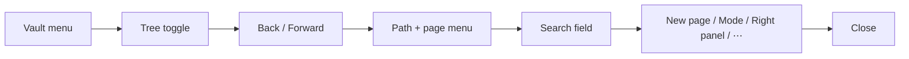
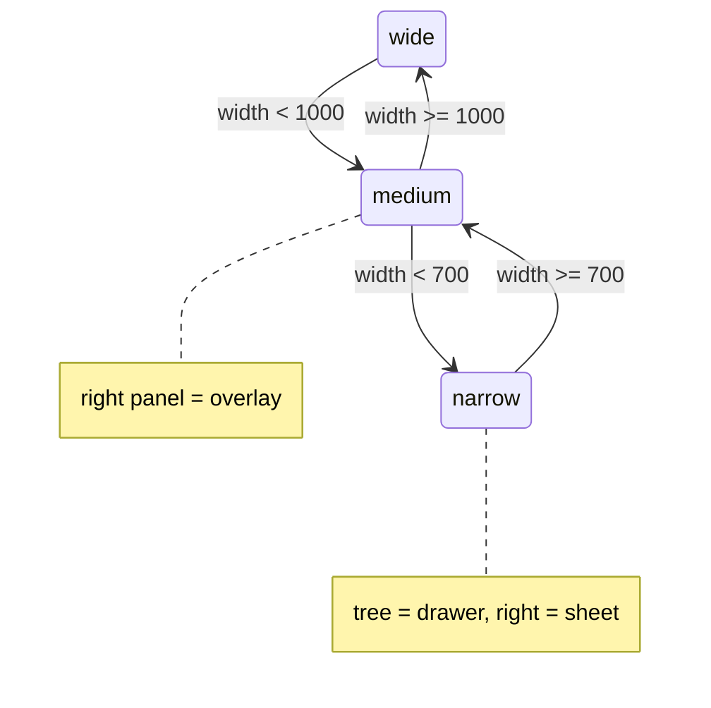

# Design

## Context

See proposal.md (Why) for the problem. Relevant current state:

- `TitleBar.svelte` is a 32px drag bar. It tags each non-interactive child with
  `data-tauri-drag-region`, because the attribute is not inherited.
- `+layout.svelte` holds:
  - the vault header and sidebar footer (help, theme);
  - all global hotkeys, in one `keydown` handler;
  - the vault selector modal.
- `PageList.svelte` has its own "Pages" header (search, new folder, new page).
- `PageEditor.svelte` floats a mode button over Carta's toolbar, and
  `app.css` forces that toolbar to 48px.
- The right panel is closed by a ✕ in `RightSidebarPanel.svelte` and reopened
  by a floating button in `+page.svelte`.
- The UI settings live in `core/src/ui_settings.rs`. They already store
  `right_sidebar_visible` and the panel widths.
- The project uses Tauri 2.12.5. Since 2.11, `data-tauri-drag-region="deep"`
  makes clicks on non-clickable children drag too, and double-click toggles
  maximize ([tauri drag.js 2.11](https://docs.rs/crate/tauri/2.11.1/source/src/window/scripts/drag.js),
  [window customization](https://v2.tauri.app/de/learn/window-customization/)).

## Goals / Non-Goals

**Goals:**
- One component owns the toolbar. Every other component loses its header.
- A single action registry feeds the toolbar menus, the command mode, the
  hotkey handler and the shortcuts help, so they cannot drift apart.
- Layout decisions come from one width class, computed once.

**Non-Goals:**
- No mobile build, no touch gestures beyond tap. Swipe-to-open is left out.
- No user-configurable toolbar or hotkeys.
- No change to dialog components (New page, Rename, Move and so on), except
  that they are opened from new places.

## Decisions

### D1. One action registry (`src/lib/actions.ts`)

Each action is `{ id, label, icon, hotkey?, synonyms?, when?(app), run(app) }`.

- The toolbar's ⋯ menu, page menu and command mode list actions by id.
- `KeyboardHelp` renders its global section from the registry.
- The global `keydown` handler in `+layout.svelte` matches registry hotkeys,
  replacing its hand-written `if` chain.
- Context-specific keys stay where they are: tree `j`/`k`/`h`/`l`, preview
  `j`/`k`, and editor `i`/`Esc`.

*Alternative:* keep the per-component handlers and add entries to each list by
hand. Rejected: that is exactly how SPARQL and "Add vault" ended up with no
on-screen entry point.

### D2. Toolbar component replaces `TitleBar.svelte`

`WindowToolbar.svelte` is a flex row with `data-tauri-drag-region="deep"` on
the bar itself. Buttons are clickable elements, so they never drag. That
removes the per-child attributes.

```
┌────────────────────────────────────────────────────────────────────────────┐
│ [▣ Notes ▾] [◧] [←][→]  Projects / Index ▾ •   [⌕ Search pages or > … ^P]  │
│                                   [+] [👁] [◨] [⋯] │ [✕]                    │
└────────────────────────────────────────────────────────────────────────────┘
  vault       tree hist   path + page menu       search          actions  quit
```



**Carta's own toolbar.** In preview it would be an empty strip above the page,
so `PageEditor` hides it there. In write mode it keeps only Carta's formatting
buttons (Bold, Italic, ...); its Write/Preview tabs stay hidden. These buttons
edit the text, they are not a header bar, and the e2e typing check clicks Bold.
They show only while editing.

**Panel titles.** The right panel's "Backlinks" and "Attachments" titles are
section headings that scroll with their content, not fixed header bars.

### D3. Menus use the existing `RowMenu` pattern

The tree's `RowMenu.svelte` already does a keyboard-navigable popup. The vault,
page and ⋯ menus reuse it. The vault menu keeps today's modal selector, which
has rich rows with paths and needs room. The other menus are popups.

Which toolbar menu is open is kept in `app.toolbarMenu`, not in the toolbar
component. `closeAllDialogs()` clears it and `anyDialogOpen()` counts it, so a
hotkey that opens a dialog closes the menu first, and plain-key hotkeys (`r`,
`m`, `Del`, preview `j`/`k`) do not run behind it. `RowMenu` stops the
propagation of every key it handles.

### D4. Width class from one `ResizeObserver`

`app.widthClass` is one of `'wide' | 'medium' | 'narrow'`. It is set from a
`ResizeObserver` on `document.body`. Breakpoints: 1000px and 700px.

- Components read the class; they do not use CSS media queries for layout
  decisions. That keeps the docked/overlay logic in TypeScript, where the
  "Docked panel state is kept per width class" rule lives.
- Pure styling, such as path truncation, may still use CSS.

`app.showLeftSidebar` and `app.showRightSidebar` mean "docked in the wide
layout". Overlay state lives in a separate `app.overlay` field:
`null | 'tree' | 'right'`. Overlays are never persisted.



### D5. Command mode inside `GlobalSearch`

A leading `>` switches the result source from pages to `actions.filter(when)`.
Matching uses the same case-insensitive substring test that page search uses
today, run over `label` plus `synonyms`. There is no fuzzy scorer in the
codebase yet, and adding one is out of scope.
"Recently run" is an in-memory list; it is not persisted.

`Ctrl+Shift+P` opens search with `>` prefilled, following the VS Code
convention where `>` in Quick Open (`Ctrl+P`) turns it into the Command Palette
([VS Code default keybindings](https://code.visualstudio.com/docs/reference/default-keybindings)).

*Alternative:* `Ctrl+K`. Rejected: Markdown editors commonly bind `Ctrl+K` to
"insert link", and that is a likely future editor shortcut here.

### D6. Hotkey choices

- `Ctrl+E` for edit/preview is the same default as Obsidian's reading-view
  toggle, so it is familiar to the target users
  ([Obsidian help: edit and read](https://obsidian.md/help/edit-and-read)).
  It does not clash with the existing `Ctrl+Shift+E`, which opens the SPARQL
  console.
- `Ctrl+\` / `Ctrl+Shift+\` toggle the panels. They are symmetric and unused.
  `Ctrl+B` was rejected because it is bold in Markdown editors.

### D7. Minimum window size

`tauri.conf.json` sets `minWidth: 360` and `minHeight: 480`. Since Tauri
2.0.0-beta.25, min constraints are honoured on their own
([release notes](https://v2.tauri.app/release/tauri/v2.0.0-beta.25/)).

### D8. Narrow-layout tabs for the right panel

`RightSidebarPanel` and `AttachmentsPanel` get a `variant` prop:
`'stack' | 'tabs'`. The sheet uses `tabs`; the docked and floating panels keep
today's stacked sections.

## Risks / Trade-offs

- **Removing `TitleBar` and the headers breaks e2e selectors.** Update those
  specs in the same task group that removes each control, and add
  `data-testid`s to the toolbar.
- **`data-tauri-drag-region="deep"` behaves differently on macOS.** There,
  maximize fires on mouseup and can be cancelled by moving the pointer. Accept
  this, since it is platform behaviour.
- **Too many toolbar buttons at 1000–1100px.** The search field has a
  `min-width` and shrinks first, then the medium layout takes over.
  `scripts/screenshot.sh -s 1000x700` is part of the check.
- **`Ctrl+\` on non-US keyboard layouts.** Match on `e.code === 'Backslash'`,
  not on `e.key`.
- **The 2-column wide layout loses the Pages label.** The tree loses its
  "PAGES" title, but it is the only thing in that column, so no context is
  lost.

## Migration Plan

Frontend only, apart from one new optional settings field. A missing
`left_sidebar_visible` field means "shown". Rollback means reverting the
commit; old settings files stay valid both ways.
